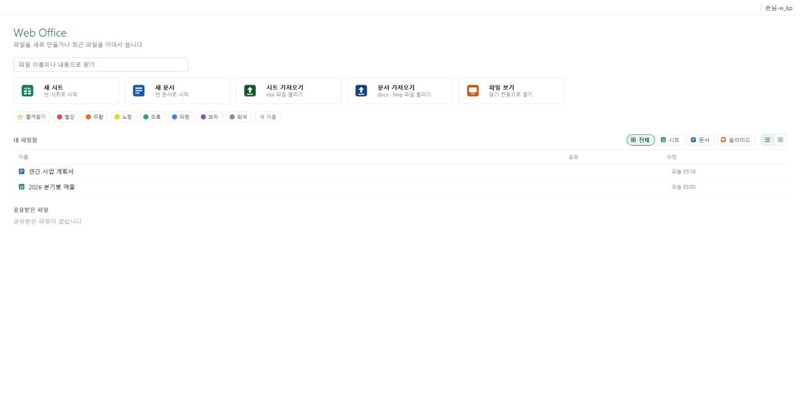
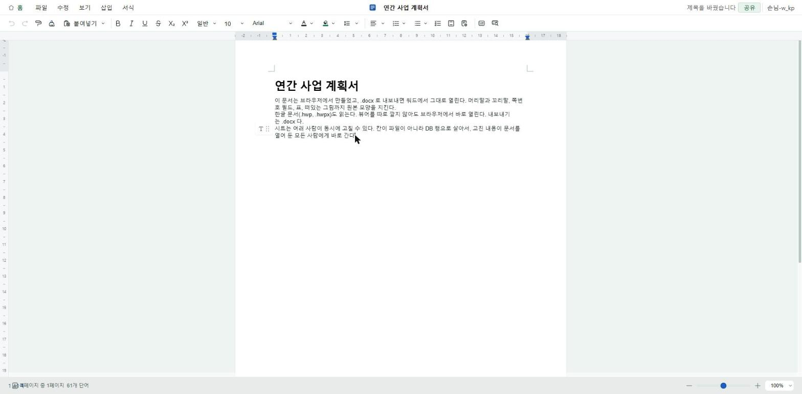

# Web Office

[English](README.md) · 한국어

브라우저에서 워드 문서와 엑셀 시트를 열고 고치는 자가호스팅 오피스.
시트는 여러 사람이 동시에 고칠 수 있다. **한글 문서(.hwp, .hwpx)를 읽는다.**

화면 그리기는 [Univer](https://github.com/dream-num/univer), 파일 다루기는
[Apache POI](https://poi.apache.org/), 서버는 Spring Boot 와 PostgreSQL 이다.



| 시트 | 문서 |
|---|---|
|  |  |

> **아직 이른 판이다.** 돌아가고 시험도 있다(백엔드 852 · 프런트 669). 다만
> 믿고 쓰기 전에 [안 되는 것](#안-되는-것)을 먼저 읽어라.
>
> `docker compose up` 은 끝까지 돌려 봤다. 두 컨테이너가 healthy 에 닿고,
> 들어온 사람에게 손님 신원이 생기고, 문서와 칸이 남고, 모든 페이지와 묶음이
> 나가고, 열린 모드에서 관리자 화면이 막히고, 등록 모드의 초대부터 로그인까지
> 흐른다.

## 띄우기

```sh
docker compose up
```

<http://localhost:8710> 을 열면 된다.

설치는 이것으로 끝이다. compose 가 PostgreSQL 을 올리고, 스키마를 한 번 넣고,
앱을 빌드하고, DB 가 질의를 받을 때까지 기다린 뒤 앱을 띄운다.

기본값에는 **로그인 화면이 없다.** 페이지를 연 사람은 쿠키에 담긴 손님 신원을
받고 바로 문서를 만들고 나눠 쓴다. [누가 들어올 수 있나](#누가-들어올-수-있나)
를 보라.

빈 DB 로 다시 시작하려면:

```sh
docker compose down -v
```

### Docker 없이

JDK 21 과 PostgreSQL 이 필요하다. 프런트는 Maven 이 빌드한다 — Node.js 를
스스로 내려받으니 따로 깔지 않아도 된다.

```sh
psql -h <호스트> -U <사용자> -d <DB> -f db/schema-postgresql.sql

export WO_DB_HOST=<호스트> WO_DB_NAME=<DB> \
       WO_DB_USER=<사용자> WO_DB_PASSWORD=<비밀번호>
mvn package
java -jar target/*.jar --spring.profiles.active=postgresql
```

## 되는 것

**한글 문서(.hwp, .hwpx)** — 읽기만 된다. 내보내기는 .docx 다. 한글 문서를
브라우저에서 보려고 뷰어를 따로 깔게 하지 않아도 된다.

**문서(.docx)** — 열기·고치기·내보내기. 머리말과 꼬리말(첫 장만 다른 것도),
장마다 다시 세는 쪽번호 필드, 표, 떠 있는 그림, 내용 컨트롤. 쪽 수는 원본과
맞춰 확인한다 — 어림하지 않는다.

**시트(.xlsx)** — 열기·고치기·내보내기. 수식 함수 540개, 조건부 서식, 데이터
유효성, 정렬, 자동 필터, 표, 메모, 스레드 댓글, 하이퍼링크, 그림.

**시트 동시 수정** — 칸이 파일이 아니라 DB 행으로 산다. 그래서 칸 수정, 행
높이, 병합, 그림, 시트 탭까지 문서를 열어 둔 모든 사람에게 WebSocket 으로
간다. 남이 어디를 보고 있는지 색으로 보인다. 수정은 기록되고, 복원 지점을
찍어 되돌릴 수 있다.

**끼워 넣기 API** — 다른 시스템이 문서를 `POST` 하면 브라우저에서 보기 전용으로
열리는 1회용 주소를 받는다. 기본은 꺼져 있다. [설정](#설정)을 보라.

## 안 되는 것

알고 그렇게 둔 것들이다. 깔고 나서가 아니라 깔기 전에 판단하라고 적는다.

- **문서는 동시 수정이 안 된다.** 시트만 실시간이다. 두 사람이 같은 문서를
  열면 나중에 저장한 쪽이 앞사람 작업을 **통째로** 덮는다 — 문서는 전체
  snapshot 으로 저장되기 때문이다.
- **시트 충돌은 나중 쓴 쪽이 이긴다.** OT 도 CRDT 도 아니다. 두 사람이 같은
  칸을 고치면 한쪽이 **경고 없이 조용히** 사라진다.
- **피벗 테이블·차트·스파크라인이 없다.** 그리기 엔진의 유료 기능이다.
- **머리말 안의 표가 그려지지 않는다.** 엔진 한계다. 넣으면 머리말이 통째로
  비어 버린다.
- **DRM 걸린 파일을 알아보지 못한다.** 판별이 재배포할 수 없는 상용
  라이브러리에 있었다. 그런 파일은 깨진 파일로 실패한다.
- **메일을 보내지 않는다.** 초대는 복사해서 전해 주는 주소다.

## 누가 들어올 수 있나

설정 하나로 갈린다.

```yaml
weboffice:
  auth:
    mode: open        # open | registered
```

### `open` (기본값)

로그인 화면이 없다. 들어온 사람마다 `HttpOnly` 쿠키에 손님 신원이 생기고
`손님-ab12` 로 보인다. 손님도 자기가 만든 문서의 주인이고, 접속 표시와 수정
기록에 남는다. 쿠키를 지우면 다른 사람이 된다.

주인과 공유 권한은 지킨다 — 남의 비공개 문서는 열 수 없다. 그러나 **누구나
걸어 들어와 신원을 만들 수 있으니 믿을 수 있는 망에서만 써라.** 이 모드에서는
관리자 화면이 닫힌다 — 아무도 역할을 가질 수 없어 감사 콘솔에 닿지 못한다.

### `registered`

관리자가 등록한 사람만 들어온다.

1. `WO_AUTH_MODE=registered` 와 `WO_ADMIN_EMAIL=you@example.com` 을 둔다.
2. 처음 켜질 때 서버가 그 계정을 만들고 1회용 초대 주소를 **자기 로그에**
   찍는다. 거기서 복사한다.
3. 그 주소를 열어 비밀번호를 정하면 관리자로 들어간다.
4. `/admin/users` 에서 남을 등록한다. 등록마다 초대 주소가 나오니 원하는
   방법으로 전해 준다.

관리자는 남의 비밀번호를 보지도 정하지도 않는다 — 초대받은 사람이 정한다.
비밀번호는 BCrypt 해시로, 초대 토큰은 SHA-256 해시로만 저장한다. 표가 새어도
계정이 넘어가지 않는다.

## 설정

전부 쓸 만한 기본값이 있다. 환경 변수로 준다.

| 변수 | 기본값 | 하는 일 |
|---|---|---|
| `WO_PORT` | `8710` | 호스트 쪽 포트 |
| `WO_DB_HOST` `WO_DB_PORT` `WO_DB_NAME` `WO_DB_USER` `WO_DB_PASSWORD` | compose 가 채운다 | DB 연결 |
| `WO_AUTH_MODE` | `open` | `open` 또는 `registered` |
| `WO_ADMIN_EMAIL` | 빈 값 | 첫 관리자. `registered` 에서만 |
| `WO_INVITE_HOURS` | `72` | 초대 주소가 사는 시간 |
| `WO_WS_ORIGINS` | localhost | WebSocket 을 열 수 있는 출처. 자기 호스트로 서비스하면 그 주소를 넣어라. **`*` 는 절대 쓰지 마라** — 아무 사이트나 방문자의 세션 쿠키로 연결을 열 수 있다. |
| `WO_VIEW_ENABLED` | `false` | 끼워 넣기 API. `POST /api/view/documents` 는 세션 인증을 쓰지 않는다 — API 열쇠와 주소 범위로만 막으니 켤 때 `weboffice.view.callers` 를 직접 채워라. |

## 빌드와 시험

```sh
mvn test                                     # 백엔드 852
cd frontend && npm ci && npx vitest run      # 프런트 669
```

`mvn test` 는 **따로 깐 DB 도 Docker 도 필요 없다.** 일부러 그렇게 뒀다 —
돌릴 수 없는 시험은 아무도 돌리지 않는 시험이다.

대부분은 메모리 H2 에서 돈다. 몇 개는 **진짜 PostgreSQL** 을 띄운다 —
`embedded-postgres` 가 실행 파일을 들고 와 임시 폴더에서 당신 권한으로
`initdb` 를 돌린다. H2 가 못 보는 것을 본다: 운영 스키마 전체, 부분 색인,
`jsonb` 가 깨진 JSON 을 거부하는지, `bytea` 왕복, 그리고 서버가 PostgreSQL
매퍼 가지로 떠서 응답하는지. 이 시험들이 H2 로는 보이지 않던
`DROP TABLE` 네 개 누락을 찾아냈다.

`SchemaParityTest` 가 두 스키마를 표마다 열마다 맞춰 둔다.
`PublicReleaseScanTest` 는 설정에 비밀번호나 실제 IP 가 박히는 것을 막고,
코드에 사람 실명이 남는 것도 막는다.

## 라이선스

AGPL-3.0-or-later. [`LICENSE`](LICENSE) 를 보라.

실제로 뜻하는 것: 자기 서버에 올려 쓰고 고치는 것은 자유다. **고친 판을 남에게
망으로 내주면 그 소스도 내줘야 한다.**

그것이 곤란하면 상용 라이선스가 가능하다 — 저작권이 한 사람에게 있어 따로
물어볼 곳이 없다. **idont82@gmail.com** 으로 보내라. 버그와 질문은
[Issues](https://github.com/idont82/weboffice/issues) 에,
취약점은 [`SECURITY.md`](SECURITY.md) 를 보고 비공개로.

의존성과 각 라이선스는 `src/main/resources/oss-manifest.json` 에 있다.
`OssManifestDriftTest` 가 그 파일과 `pom.xml` 이 어긋나면 빌드를 깬다. Univer
외 전부 Apache-2.0 이나 MIT 로, AGPL-3.0 이 품을 수 있다.
